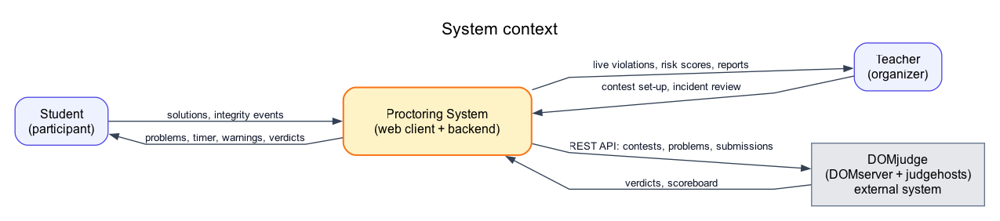
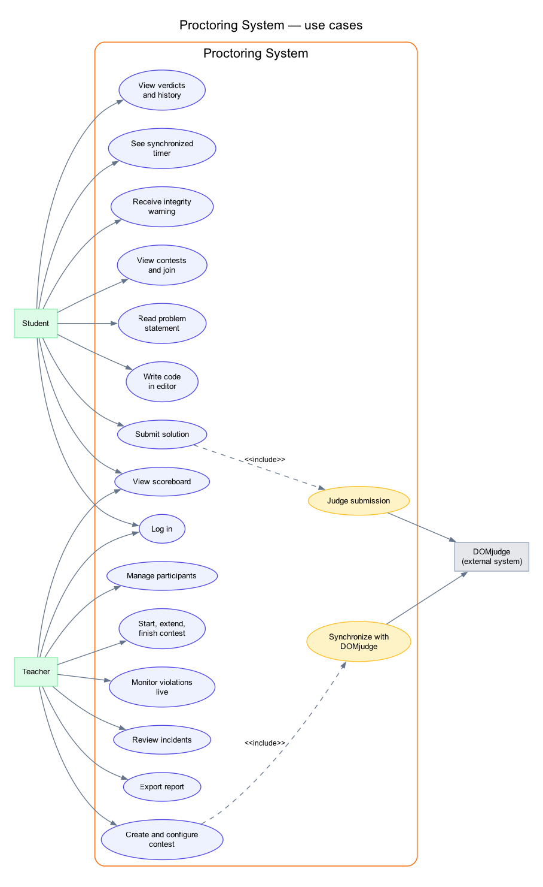
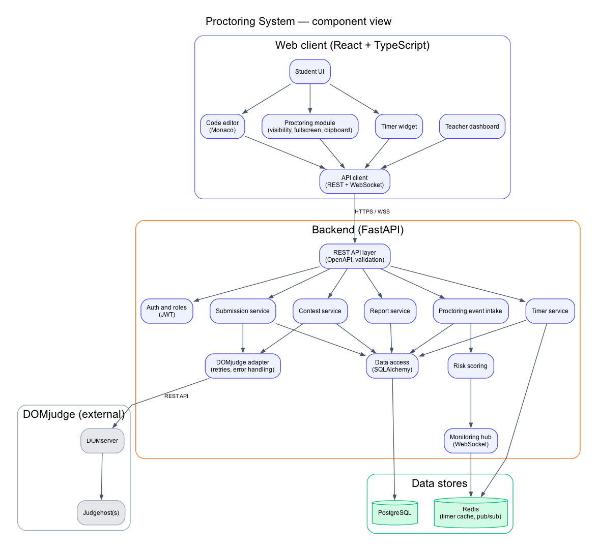
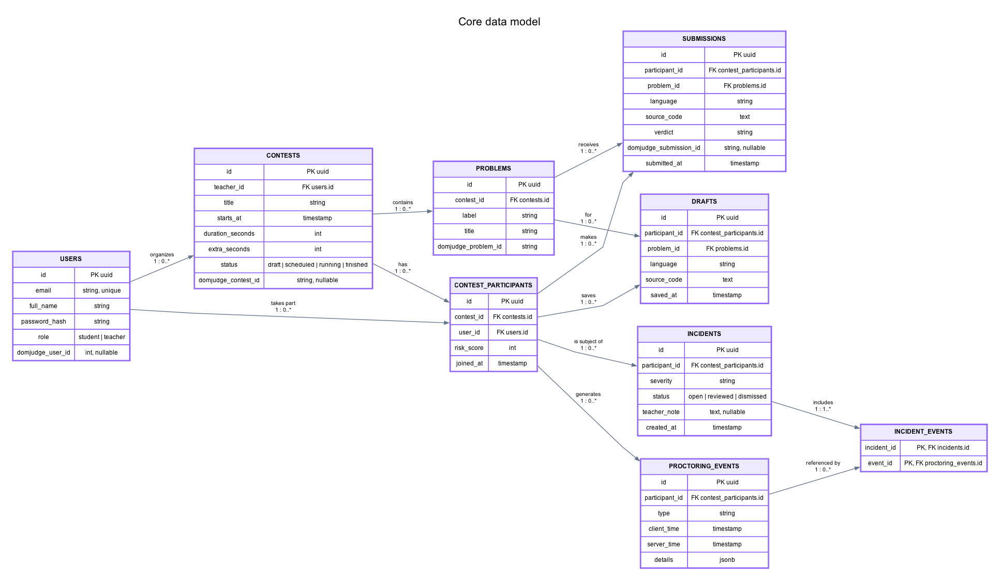
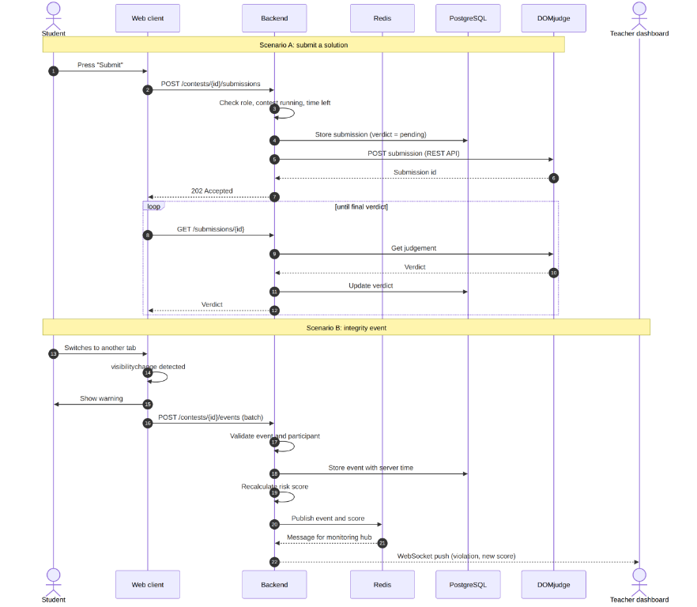

# 7. Architecture and Diagrams

**Project:** Development of a Proctoring System for Online Programming Contests
**Version:** prob-period-1
**Status:** draft architecture for the probationary period; the component diagram is a draft, as the requirements specify.

Editable sources of the diagrams are in the repository folder `diagrams/` (Graphviz `.dot` and Mermaid `.mmd` files), with PNG exports next to them.

## 7.1 Architectural principles

1. **Judging is delegated to DOMjudge.** The system does not implement a judge; it adds a participant client, integrity control and an organizer dashboard around DOMjudge (T6 in section 5).
2. **Two contours with a fixed contract.** The web client (frontend) and the backend communicate only through the REST API described in OpenAPI, plus two WebSocket channels. This is the boundary between the two team members' areas.
3. **The server is the source of truth** for time and for recorded events. The client reports; it is never trusted to decide.
4. **Prevention plus recording.** The browser blocks what it can; everything else is recorded, validated and scored on the server (T7).
5. **One module talks to DOMjudge.** Replacing or mocking the judge affects only the DOMjudge adapter.

## 7.2 Diagrams

### 7.2.1 System context

The system has two human actors, the student and the teacher, and one external system, DOMjudge. DOMjudge receives submissions and contest definitions, and returns verdicts and the scoreboard.

### 7.2.2 Use case diagram

The student reads problems, writes and submits code, sees the timer and receives integrity warnings. The teacher creates and controls contests, monitors violations live, reviews incidents and exports reports. Two use cases involve DOMjudge: judging a submission and synchronizing a contest.

### 7.2.3 Component diagram (draft)

### 7.2.4 Data model

### 7.2.5 Key scenarios

## 7.3 Components and responsibilities

| Component | Responsibility | Requirements |
|---|---|---|
| Student UI | Contest list, problem page, submission history, warnings | FR-05, FR-06, FR-10, FR-19 |
| Code editor (Monaco) | Syntax highlighting, language choice, templates, clipboard blocking, draft autosave | FR-07, FR-08, FR-17 |
| Proctoring module | Detects tab/window change, full-screen exit, copy/paste/cut/context menu; batches events and sends them | FR-15, FR-16, FR-17 |
| Timer widget | Shows remaining time using server-synchronized offset; disables submission at zero | FR-14, NFR-01 |
| Teacher dashboard | Contest set-up, participant list, live feed, incident review, report | FR-02, FR-03, FR-13, FR-21 – FR-23 |
| API client | REST and WebSocket access, reconnection, token handling | NFR-13 |
| REST API layer | Routing, validation, OpenAPI generation, error format | NFR-05 |
| Auth and roles | Login, JWT, role checks on every endpoint | FR-01, NFR-09 |
| Contest service | Contest and participant lifecycle, status changes | FR-02 – FR-05, FR-13 |
| Submission service | Accept submissions, check contest state and time, store, track verdicts | FR-09, FR-10 |
| DOMjudge adapter | All calls to DOMjudge with retries, timeouts, error mapping | FR-04, FR-09, FR-11, FR-25 |
| Timer service | Authoritative start/end time, remaining-time endpoint, automatic closing | FR-12, FR-13 |
| Proctoring event intake | Validates and stores events with server time; detects sequence gaps and lost heartbeat | FR-18, NFR-09 |
| Risk scoring | Computes participant risk score from the event log | FR-20 |
| Monitoring hub | Pushes events and scores to teachers over WebSocket via Redis publish/subscribe | FR-21, NFR-02 |
| Report service | Aggregates results, events and incidents; exports CSV/JSON | FR-23 |
| PostgreSQL | Persistent data | section 7.4 |
| Redis | Timer cache, publish/subscribe between workers, rate limiting | NFR-01, NFR-02, NFR-03 |

## 7.4 Data model

The entities and their relations are shown in 7.2.4. Design notes:

- A **contest participant** is a separate entity linking a user to a contest, so that submissions, drafts, events and incidents belong to a participation, not directly to an account.
- **Proctoring events** store both `client_time` and `server_time`; reports use `server_time`. Event-specific data (for example how long the page was hidden) goes into a JSON field.
- **Incidents** are created by the risk logic or by the teacher from a group of events. The `incident_events` association links each incident to its supporting events; incidents carry the teacher's decision (`open`, `reviewed`, `dismissed`) and note.
- Identifiers of DOMjudge objects (`domjudge_contest_id`, `domjudge_problem_id`, `domjudge_submission_id`, `domjudge_user_id`) are stored so that synchronization is repeatable without duplicates.
- Personal data is limited to name, e-mail and the event log (NFR-10).

## 7.5 API outline (REST, base path `/api/v1`)

The contract will be written as an OpenAPI specification in `docs/api/openapi.yaml` and kept as the single source of truth for both team members. The outline below has **35 REST endpoints and 2 WebSocket channels**, above the target of 25 (NFR-05).

| # | Method and path | Role | Purpose | Requirement |
|---|---|---|---|---|
| 1 | POST `/auth/login` | any | Log in, receive tokens | FR-01 |
| 2 | POST `/auth/refresh` | any | Refresh access token | FR-01 |
| 3 | POST `/auth/logout` | any | End session | FR-01 |
| 4 | GET `/users/me` | any | Current user and role | FR-01 |
| 5 | POST `/users` | teacher | Create a user | FR-03 |
| 6 | GET `/users` | teacher | List users | FR-03 |
| 7 | GET `/contests` | any | Contests visible to the user | FR-05 |
| 8 | POST `/contests` | teacher | Create contest | FR-02 |
| 9 | GET `/contests/{id}` | any | Contest details | FR-05 |
| 10 | PATCH `/contests/{id}` | teacher | Edit contest | FR-02 |
| 11 | POST `/contests/{id}/sync` | teacher | Synchronize with DOMjudge | FR-04 |
| 12 | POST `/contests/{id}/start` | teacher | Start contest | FR-12 |
| 13 | POST `/contests/{id}/extend` | teacher | Extend duration | FR-13 |
| 14 | POST `/contests/{id}/finish` | teacher | Finish contest | FR-13 |
| 15 | GET `/contests/{id}/participants` | teacher | List participants | FR-03 |
| 16 | POST `/contests/{id}/participants` | teacher | Add participants | FR-03 |
| 17 | DELETE `/contests/{id}/participants/{user_id}` | teacher | Remove participant | FR-03 |
| 18 | POST `/contests/{id}/join` | student | Enter a running contest | FR-05 |
| 19 | GET `/contests/{id}/problems` | any | List problems | FR-06 |
| 20 | GET `/contests/{id}/problems/{problem_id}` | any | Problem statement | FR-06 |
| 21 | GET `/contests/{id}/problems/{problem_id}/draft` | student | Read saved draft | FR-08 |
| 22 | PUT `/contests/{id}/problems/{problem_id}/draft` | student | Save draft | FR-08 |
| 23 | POST `/contests/{id}/submissions` | student | Submit solution | FR-09 |
| 24 | GET `/contests/{id}/submissions` | any | Own submissions (student) or all (teacher) | FR-10 |
| 25 | GET `/submissions/{id}` | any | Submission with verdict | FR-10 |
| 26 | GET `/contests/{id}/scoreboard` | any | Scoreboard | FR-11 |
| 27 | GET `/contests/{id}/time` | any | Server time, end time, remaining | FR-12, FR-14 |
| 28 | POST `/contests/{id}/events` | student | Send batch of proctoring events | FR-18 |
| 29 | GET `/contests/{id}/events` | teacher | Event log with filters | FR-21 |
| 30 | GET `/contests/{id}/participants/{user_id}/risk` | teacher | Risk score and its components | FR-20 |
| 31 | GET `/contests/{id}/incidents` | teacher | List incidents | FR-22 |
| 32 | PATCH `/incidents/{id}` | teacher | Review, dismiss, add note | FR-22 |
| 33 | GET `/contests/{id}/report` | teacher | Contest report | FR-23 |
| 34 | GET `/contests/{id}/report/export` | teacher | Export CSV or JSON | FR-23 |
| 35 | GET `/health` | public | Service health check | NFR-12 |
| WS-1 | `/ws/contests/{id}/monitor` | teacher | Live events and scores | FR-21 |
| WS-2 | `/ws/contests/{id}/session` | student | Heartbeat and timer synchronization | FR-14, FR-18 |

Examples of requests and responses are in section 8.

## 7.6 Design of the critical mechanisms

### Server timer (FR-12, FR-14, NFR-01)

The server stores `ends_at = starts_at + duration + extra`. The client calls `GET /contests/{id}/time`, measures the round-trip time, and computes its clock offset from the server time and half of the round trip. It repeats the measurement periodically, after every reconnection and when the tab becomes visible again. The timer shown to the participant is `ends_at − (local time + offset)`. Submission is rejected by the server after `ends_at` regardless of what the client shows. The synchronization period is a tuning parameter to be set by measurement (metric M1).

### Event handling (FR-15 – FR-18, FR-20, NFR-09)

The client batches events and sends them over HTTPS; each event carries a per-participant sequence number and the client timestamp. The server checks that the contest is running and that the participant belongs to it, assigns server time, and stores the event. Because the client code runs on the participant's machine, the server does not rely on it alone:

- **sequence gaps** and duplicate numbers are flagged;
- if the heartbeat on the session channel stops for longer than a set interval, the server records a `heartbeat_lost` event, which also covers the case where client checks were disabled;
- request rate is limited per participant.

### Risk score (FR-20) — initial proposal

The score is computed from the event log by weighting event types (for example, a paste attempt counts more than a context-menu click), merging events caused by the same action, and capping the total at 100. Levels (low, medium, high) are set by thresholds. **Weights and thresholds are placeholders** to be calibrated on the first measurements and on the pilot; the score supports the teacher's decision and never penalizes automatically.

## 7.7 Deployment view

| Part | Technology | Note |
|---|---|---|
| Web client | Static build served over HTTPS | React, Vite |
| Backend | FastAPI application, several workers | Stateless; shared state in Redis and PostgreSQL |
| Database | PostgreSQL | Alembic migrations |
| Cache and messaging | Redis | Timer cache, publish/subscribe, rate limits |
| Judge | DOMserver and one or more judgehosts | Test stand deployed by the team |
| Packaging | Docker and Docker Compose | One command brings up the whole stack (NFR-12) |
| Automation | GitHub Actions or GitLab CI | Tests on every pull request (NFR-14) |

## 7.8 Security and privacy

Passwords are stored as hashes; tokens are short-lived with refresh; HTTPS and WSS are used throughout; every endpoint checks the role and ownership (a student cannot read another participant's data); the repository holds no secrets (placeholders in configuration examples). Only the event types of FR-15 – FR-17 and the heartbeat are collected; there is no camera, microphone or screen capture, and participants are informed before the contest starts (NFR-10). The retention period of event logs is to be agreed with the supervisor.

## 7.9 Consistency check

| Check | Result |
|---|---|
| Every Must requirement of section 6 is covered by at least one component in 7.3 | Yes (traceability in 6.4) |
| Every endpoint in 7.5 refers to a requirement | Yes |
| Every entity in the ER diagram is used by at least one endpoint | Users: 1–6; contests: 7–14; participants: 15–18; problems: 19–20; drafts: 21–22; submissions: 23–25; events: 28–29, WS; incidents and incident-event links: 29, 31–32 |
| Both scenarios of the sequence diagram (submit, integrity event) map to endpoints and components | Submit: endpoints 23, 25 → submission service → DOMjudge adapter. Event: endpoint 28 → intake → risk scoring → monitoring hub → WS-1 |
| Technology choices in section 5 appear in the component and deployment views | Yes (FastAPI, PostgreSQL, Redis, WebSocket, React, Monaco, DOMjudge REST API, browser APIs) |

## 7.10 Known limits and next steps

- The risk score weights, the retention period and the exact event batching interval are not fixed yet.
- The OpenAPI specification still has to be written from the outline in 7.5; this is the first task of the next stage and is needed before the two parts diverge.
- The component diagram is a draft and will be refined when the DOMjudge test stand reveals the real shape of its API responses.
